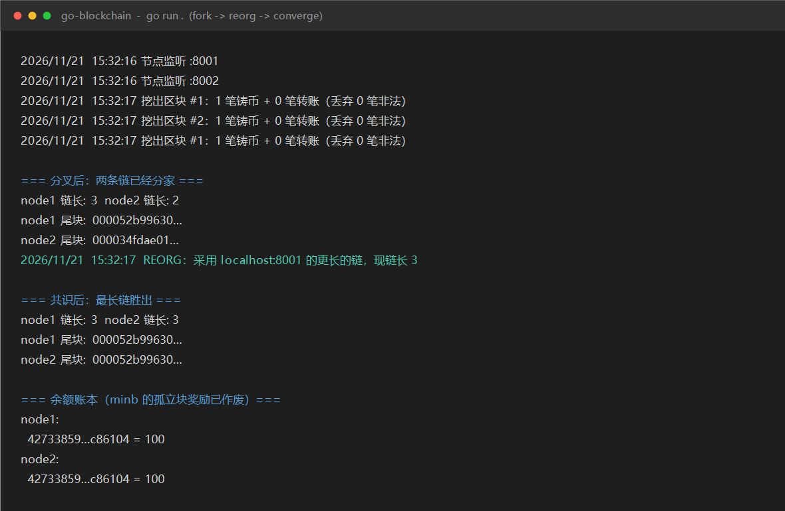

# Go 区块链节点（P2P 分布式账本）

[](https://github.com/syzua/go-blockchain/actions/workflows/ci.yml)

用 Go 从零实现的一条简化区块链 —— 多节点 P2P 同步 + 工作量证明 + ed25519 数字签名交易 + 账户余额账本 + 最长链共识 + **BadgerDB 落盘持久化**。网络、并发、加密都来自标准库，存储用的是 Go 原生的嵌入式 KV 数据库 [BadgerDB](https://github.com/dgraph-io/badger)。

> 这是一个学习/个人项目，目标是覆盖后端四大块（网络、并发、加密、存储），而不是生产级公链。文末「简化的地方」如实列出了它和真实区块链的差距。

## 能做什么（特性）

- **区块 + 哈希链**：每个区块用 SHA-256 算指纹，后一个区块的 `prev_hash` 咬住前一个，串成不可篡改的链。
- **工作量证明（PoW）**：挖矿穷举 nonce，直到区块哈希以 N 个 `0` 开头（难度可配）。
- **钱包 + 交易**：ed25519 公私钥；交易用私钥签名、用公钥验签，改一个字节都会验签失败。
- **账户模型（余额账本）**：每笔交易打包前校验付款方余额，杜绝「凭空转账」和同块内双花；挖矿发铸币奖励作为货币来源，铸币金额被强制锁定为固定值，防止凭空印钱。
- **区块校验**：外来块除校验哈希自洽、PrevHash 咬合、交易合法外，还要校验哈希是否真的满足难度门槛（没花算力的伪造块会被拒绝）。
- **最长链共识 + 分叉处理**：节点后台周期拉取 peer 链，采纳「更长且合法」的链（reorg），孤立块的奖励随之作废。
- **P2P 网络**：多个节点之间广播新区块、自动同步，最终收敛到同一条链。
- **并发**：goroutine + channel 并发广播区块，`sync.Mutex` 保证链和交易池线程安全。
- **持久化（真数据库）**：整条链存进 BadgerDB——每个区块按哈希存一条，外加一个「链尾指针」，重启自动恢复并重新校验。

## 架构 / 文件结构

| 文件 | 职责 |
|---|---|
| `block.go` | `Block` 结构、`calcHash` 哈希、`mine` 挖矿、`Blockchain` 链与余额账本（增块/验链/收外块/重放账本/最长链 reorg） |
| `transaction.go` | `Transaction` 结构、`Sign` 签名、`Verify` 验签、`IsCoinbase` 铸币判断 |
| `wallet.go` | `Wallet`：生成 ed25519 密钥对，公钥 hex 当地址 |
| `server.go` | `Server`：HTTP 节点，5 个接口 + `syncLoop` 后台同步 + `broadcast` 并发广播 + `mutex` 加锁 + 优雅关闭 |
| `storage.go` | `Store`：封装 BadgerDB，按 `block:<hash>` 存区块 + `last` 存链尾指针 |
| `config.go` | `Config`：flag 解析端口/难度/peers/落盘目录 |
| `main.go` | 两节点分叉演示 + 单节点模式：起节点、分叉、reorg、查余额 |
| `*_test.go` | 单元测试：创世块/篡改检测/余额账本/双花/最长链共识/重复消费/持久化恢复 |

存储层的 key 设计（KV 数据库里的一条链就长这样）：

```
"last"         → 最新区块哈希（链尾指针）
"block:<hash>" → 某个区块的 JSON
```

数据流示意（一次挖矿触发广播）：

```
node1 挖出新块 → [goroutine① 发往 node2] ┐
                 [goroutine② 发往 node3] ┴→ results chan → for range 收满结果
```

## 快速开始

要求：Go 1.21 及以上（新项目会先拉取 BadgerDB 依赖，国内可配置 `GOPROXY=https://goproxy.cn,direct`）。

```bash
git clone https://github.com/syzua/go-blockchain.git
cd go-blockchain
go run .
```

程序会启动 2 个节点（`:8001` / `:8002`），演示一段完整剧情：两个节点先各自挖矿产生**分叉** → 联网后按**最长链**达成共识（reorg）→ 孤立块的奖励作废：



（地址和哈希每次不同；`minb` 是 node2 的矿工地址，node2 换链后它的 50 奖励因孤立块作废。）

演示模式每次会清空重来（保证分叉可复现）。想看**持久化**，跑单节点模式，Ctrl+C 退出后再起一次，区块数会接着涨：

```bash
go run . -demo=false -data=chain.db   # 第一次：挖几块后 Ctrl+C
go run . -demo=false -data=chain.db   # 第二次：从 BadgerDB 恢复，接着之前的高度
```

## Docker

两阶段构建：`golang:1.21-alpine` 里编译，最终镜像只放一个静态二进制。

```bash
docker build -t go-blockchain .
docker run --rm -p 8001:8001 -v ${PWD}/data:/data go-blockchain
# 想跑分叉演示：docker run --rm go-blockchain -demo=true
```

## HTTP 接口

| 接口 | 方法 | 作用 |
|---|---|---|
| `/chain` | GET | 查整条链 |
| `/transactions` | POST | 提交一笔签名交易，验签后进交易池 |
| `/mine?miner=地址` | GET | 打包交易池挖矿（矿工得铸币奖励），并广播给所有 peer |
| `/receive` | POST | 接收别的节点广播来的区块，校验后挂链 |
| `/balances` | GET | 查每个地址的当前余额 |

## 技术栈

- **Go 1.21+**
- 标准库：`crypto/sha256`、`crypto/ed25519`、`net/http`、`encoding/json`、`sync`、`os`
- **BadgerDB v4**（嵌入式 KV 数据库，纯 Go 无需 Cgo）

## 单元测试

```bash
go test ./...
```

覆盖：创世块一致性、挖矿与难度、篡改检测、签名验签、挖矿奖励、余额不足拒绝、同块双花拒绝、完整转账链路、重启恢复账本、最长链 reorg、孤立块奖励作废、低难度伪造块拒绝、超额铸币拒绝等。

## 简化的地方（如实说明）

- **共识只有「最长链」**：节点认更长的合法链，但没有拜占庭容错（BFT），无法抵抗恶意节点作恶。
- **存储够用但简单**：BadgerDB 只存「区块 + 链尾指针」，账本仍由整条链全量重放得出（不落盘余额）；没有 UTXO、交易手续费、矿工费。
- **网络用 HTTP**：真实公链用 TCP + gossip 协议，这里用 HTTP 只为直观演示点对点。
- **交易没有 nonce**：签名载荷只含 `From/To/Amount`，同一笔签名交易理论上可被重复提交，直到余额不足。真实链用账户 nonce 或 UTXO 保证每笔交易只能花一次。

这些正是下一步可以「再加硬」的方向（UTXO、手续费、BFT、gossip 协议、数据库索引优化）。